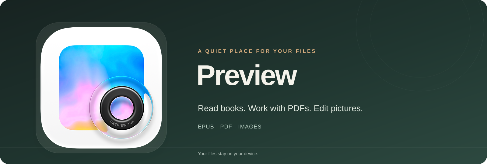
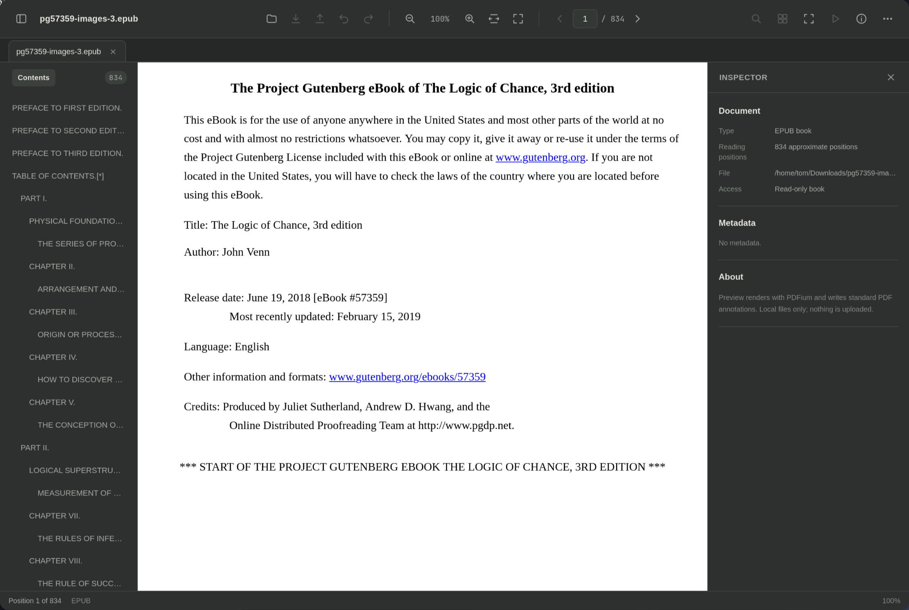
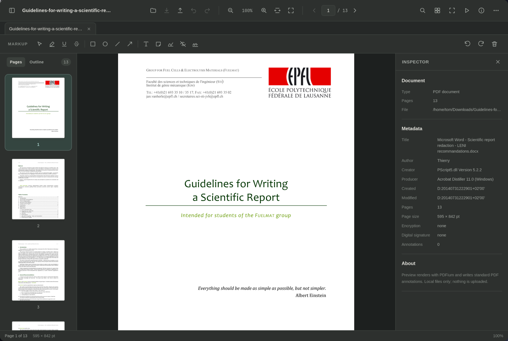
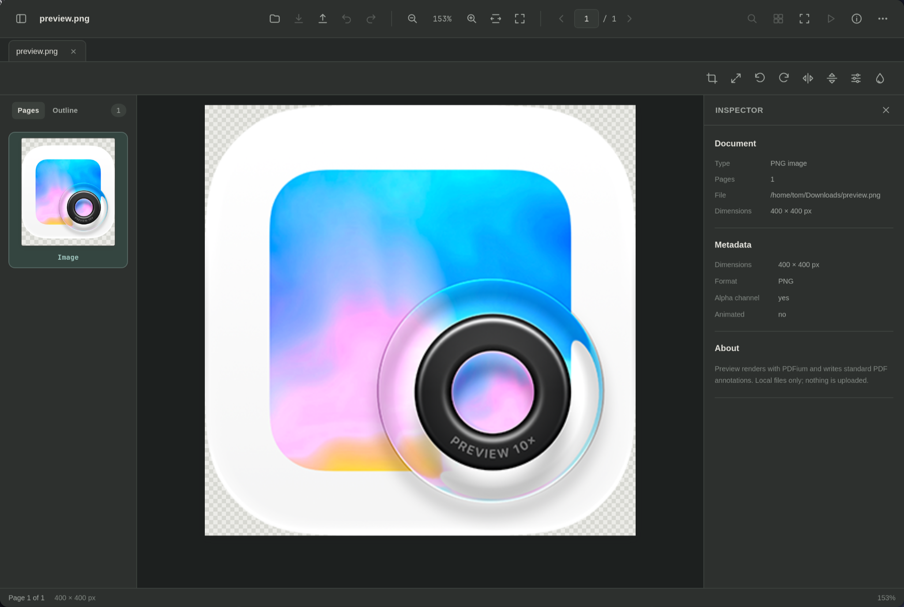

# Preview

<p align="center">
  
</p>

<p align="center"><strong>One quiet place for your books, documents, and pictures.</strong><br>
Open an EPUB, mark up a PDF, or bring a photo into focus — your files stay on your device.</p>

<p align="center"><a href="https://github.com/benclawbot/Preview/releases/latest">Download Preview</a> · <a href="#what-you-can-do">Explore the features</a></p>

## See Preview in action

### EPUB books



### PDFs



### Pictures



## Download Preview

Get the latest installers from **[Preview Releases](https://github.com/benclawbot/Preview/releases/latest)**:

| Your computer | Download |
| --- | --- |
| Omarchy / Linux x86-64 | `Preview-linux-x86_64.AppImage` |
| macOS (Apple Silicon and Intel) | `Preview-macos-universal.dmg` |
| Windows 10/11, 64-bit | `Preview-windows-x64-setup.exe` |

These community builds are not code-signed yet. macOS may ask you to confirm the first launch; on Windows, SmartScreen may show its usual warning for a new publisher.

### Install on Omarchy

The easiest route downloads the AppImage, adds Preview to your app launcher, and offers your current user the supported file associations. Existing desktop and MIME settings are backed up first.

```sh
curl -fsSLO https://raw.githubusercontent.com/benclawbot/Preview/main/scripts/install-omarchy-release.sh
bash install-omarchy-release.sh
```

You can also download the AppImage directly from the release page, make it executable with `chmod +x Preview-linux-x86_64.AppImage`, and launch it. Preview uses the system WebKitGTK runtime; install `webkit2gtk-4.1` if it is not already present. HEIC/HEIF support also needs `libheif`.

### Install on macOS

Open the downloaded `.dmg` and drag Preview into **Applications**. If Gatekeeper blocks the first launch, control-click Preview in Applications and choose **Open**.

### Install on Windows

Run the downloaded setup file and follow the prompts. After installation, open Preview from the Start menu or choose it when opening a supported file.

## What you can do

### Read EPUB books

- Open EPUB files from Preview, drag and drop, or your file manager.
- Browse the book’s table of contents and jump between chapters.
- Read reflowable pages, adjust text size, and move through approximate reading positions.
- Books are read-only in Preview. Reading stays on your device and book-embedded scripts are disabled.

EPUB reading positions are useful landmarks, not fixed pages: the number and layout change with the window size and text settings.

### Read, organize, and mark up PDFs

- Find text, follow bookmarks, browse page thumbnails, and make contact sheets.
- Zoom to fit, use full screen, present a slide show, or print through your system’s print dialog.
- Rotate, delete, reorder, insert, merge, and extract pages. Drag pages between open PDFs.
- Add highlights, underlines, strike-throughs, text, notes, shapes, arrows, and freehand ink.
- Place a signature mark drawn in Preview, captured with a camera, or loaded as an image.
- Fill supported PDF forms, protect or unlock files with a password, and use a local contact card to fill matching fields.
- Apply secure redactions that remove supported underlying content, or run OCR to make scanned pages searchable.

### Edit pictures

Open PNG, JPEG, TIFF, GIF, HEIC/HEIF, WebP, BMP, SVG, and supported camera RAW files (CR2, NEF, ARW, and DNG).

- Crop, resize, rotate, and flip.
- Adjust brightness, contrast, saturation, sharpness, levels, gamma, and curves.
- Use Instant Alpha to make matching areas transparent, and resize a batch of pictures together.
- Export pictures as PNG, JPEG, TIFF, GIF, WebP, BMP, HEIC (when a compatible encoder is installed), JPEG 2000, PSD, or PDF.
- Inspect supported file metadata and remove GPS information from supported exports.

Preview keeps edits on your device. Unmodified animated GIFs stay animated; an edited GIF is exported as a still image. Some export formats flatten transparency or layers.

## Open a file

Choose **Open a file…**, drop a file onto the Preview window, or open a supported file from your file manager. On Omarchy, the installer can make Preview the default app for EPUBs, PDFs, and supported picture formats. You can change that choice later in your desktop’s default-app settings.

Useful shortcuts:

| Action | Shortcut |
| --- | --- |
| Open a file | `Ctrl`/`⌘` + `O` |
| Find text in a PDF | `Ctrl`/`⌘` + `F` |
| Save PDF or picture edits | `Ctrl`/`⌘` + `S` |
| Zoom in / out | `Ctrl`/`⌘` + `+` / `−` |
| Return to 100% zoom | `Ctrl`/`⌘` + `0` |
| Move through a book or document | `Page Up` / `Page Down` |
| Close Preview | `Escape` or `Ctrl`/`⌘` + `W` |

Preview asks before closing when there are unsaved PDF or picture edits.

## A note about privacy and limits

Preview is designed to work with local files; it does not upload your books, PDFs, or pictures to a Preview service. EPUB book scripts are disabled. Some advanced PDF content (such as certain interactive forms, signatures, or annotations) is intentionally protected from operations that could silently discard it. Saving changes to a digitally signed PDF invalidates its existing signature. Secure redaction supports common page content but is not a substitute for independent review of sensitive documents.

## Build Preview yourself

Preview is open source. To run it from source on Linux, install Node.js, Rust, GTK 3, WebKitGTK 4.1, libheif, and the usual C/C++ build tools. Then run:

```sh
npm install
./scripts/fetch-pdfium.sh
npm run tauri dev
```

To create a local optimized Linux build and register it for your user, run:

```sh
npm run tauri build -- --no-bundle
./scripts/install-omarchy.sh
```

The GitHub release workflow creates the Omarchy/Linux, macOS, and Windows installers from native build runners. Platform builds and signing status are shown on the [Releases page](https://github.com/benclawbot/Preview/releases).
